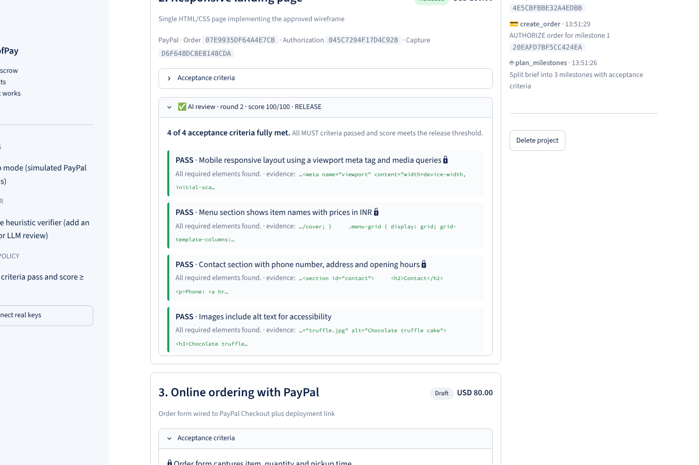

# ProofPay - AI-verified escrow for freelance work

> Clients fund milestones with PayPal. An AI agent checks the delivered work against the agreed
> criteria, then releases payment, asks for specific fixes, or writes an evidence pack for dispute review.

Built for the **PayPal AI Hackathon 2026**.

**Live demo:** https://proofpay-escrow.streamlit.app



## The problem

Cross-border freelancing runs on trust that doesn't exist. Clients pay up front and risk bad work;
freelancers deliver first and risk never being paid. When it goes wrong, disputes are slow and come
down to "he said, she said" because nobody wrote down what "done" meant.

## How ProofPay works

| Step | Who | What happens | PayPal API |
|---|---|---|---|
| 1 | AI agent | Turns a messy brief into 2-4 milestones with **objective acceptance criteria** | - |
| 2 | Client | Funds a milestone. Money is **authorized and held**, not paid out | `POST /v2/checkout/orders` (`intent: AUTHORIZE`) → `POST /v2/checkout/orders/{id}/authorize` |
| 3 | Freelancer | Submits the deliverable (paste, upload or links) | - |
| 4 | AI agent | Grades every criterion `pass / partial / fail` and quotes evidence | - |
| 5 | Policy | All MUST criteria pass and score ≥ 80 → **release** | `POST /v2/payments/authorizations/{id}/capture` |
| 6 | Policy | Otherwise → specific revision notes. After 3 failed rounds → **evidence pack** | - |
| 7 | Client | Cancel before release → hold is **voided** and returned | `POST /v2/payments/authorizations/{id}/void` |

### The AI judges, policy decides

The model never moves money by itself. It returns structured per-criterion verdicts; a deterministic
function (`decide()` in `proofpay/ai_agent.py`) weighs MUST criteria double, applies the release
threshold, and only that function triggers PayPal calls. Missing verdicts count as failures, and the
client can always override a dispute.

## Run it locally (2 minutes)

```bash
git clone https://github.com/abdulmannaan502/proofpay.git
cd proofpay
pip install -r requirements.txt
streamlit run app.py
```

Open http://localhost:8501, click **Load sample brief**, then follow the flow. With no keys the app
runs in **demo mode** (simulated PayPal responses with the real API shapes) and uses an **offline
heuristic verifier**, so judges can try everything instantly.

### Connect PayPal sandbox and an LLM

1. Create a sandbox app at https://developer.paypal.com/dashboard/applications/sandbox and copy the
   Client ID and Secret.
2. `cp .streamlit/secrets.toml.example .streamlit/secrets.toml` and fill in:

```toml
PAYPAL_CLIENT_ID = "..."
PAYPAL_CLIENT_SECRET = "..."
PAYPAL_ENV = "sandbox"
ANTHROPIC_API_KEY = "..."        # or OPENAI_API_KEY
APP_URL = "http://localhost:8501" # PayPal returns the buyer here after approval
```

3. Restart. The sidebar turns green. Funding now redirects to the PayPal sandbox checkout; log in with
   a sandbox **personal** account to approve, and you'll land back in ProofPay with the hold placed.

### Deploy on Streamlit Community Cloud

1. Push this repo to GitHub (public).
2. Go to https://share.streamlit.io → **Create app** → pick the repo, branch `main`, file `app.py`.
3. **Advanced settings → Secrets**: paste the same TOML as above, with `APP_URL` set to your
   `https://<name>.streamlit.app` URL.
4. Deploy.

## Tests

```bash
pip install pytest && pytest -q
```

Covers: plan amounts sum to budget, weak work is held then fixed work is released, third failure
escalates, missing verdicts never release money, and the authorize → capture / void lifecycle.

## Project structure

```
app.py                     Streamlit UI and escrow state machine
proofpay/paypal_client.py  OAuth, Orders v2 (AUTHORIZE), Payments v2 capture / void, demo mode
proofpay/ai_agent.py       Planner, verifier, dispute pack, deterministic release policy
proofpay/store.py          JSON persistence and activity log
proofpay/samples.py        Sample deliverables (good / weak / fixed) for the demo
tests/test_flow.py         End-to-end tests
```

## Built with

Python · Streamlit · PayPal Orders API v2 · PayPal Payments API v2 · Anthropic Claude (or OpenAI) · Streamlit Community Cloud

## Roadmap

- PayPal Payouts to split a milestone between team members
- GitHub repo and live-URL verification (run the code, screenshot the page)
- Re-authorization before the 29-day authorization window closes on long milestones
- PayPal Disputes API: attach the evidence pack automatically

## License

MIT - see [LICENSE](LICENSE).
